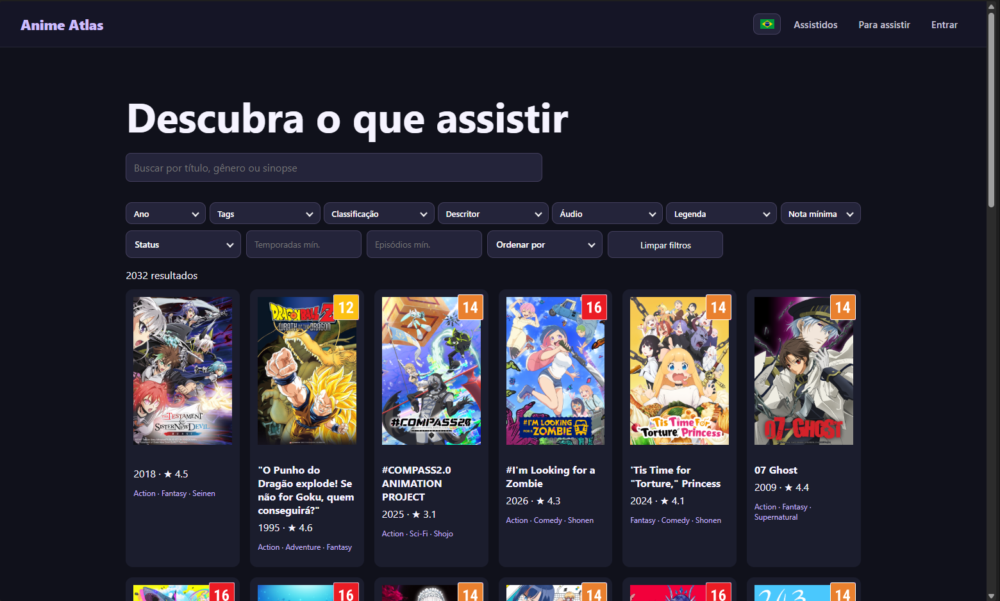
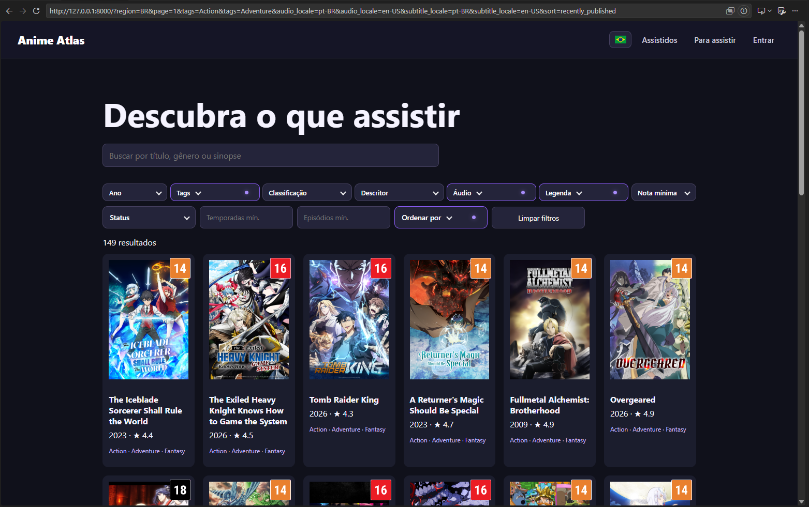
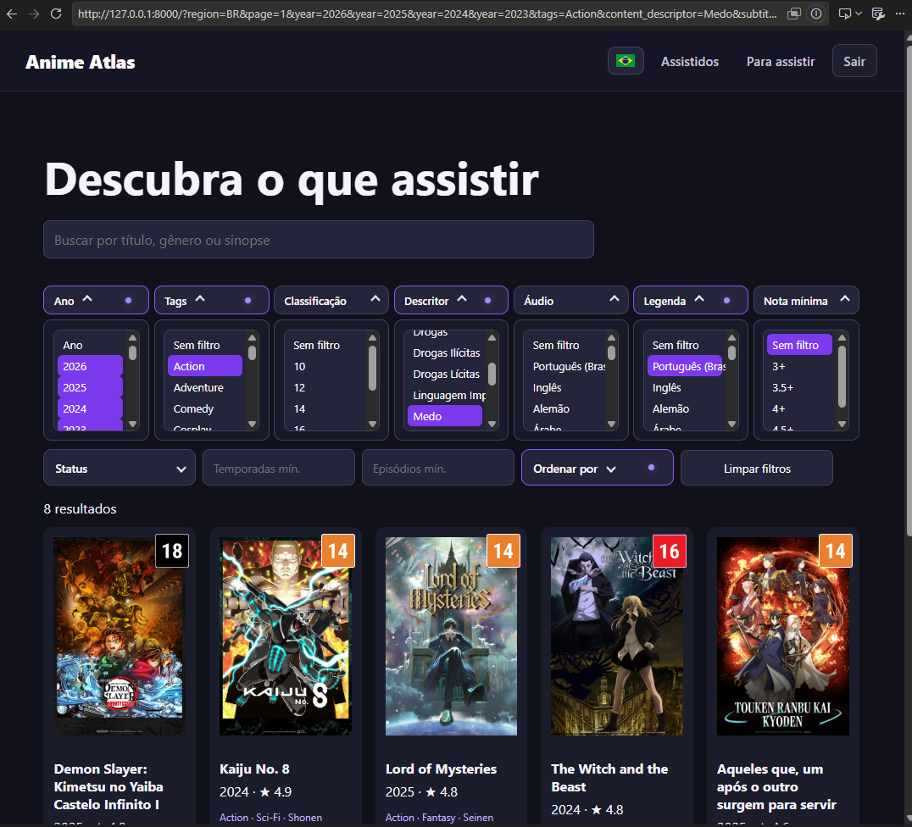
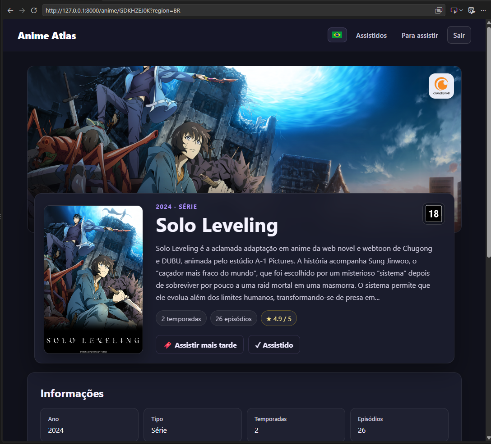
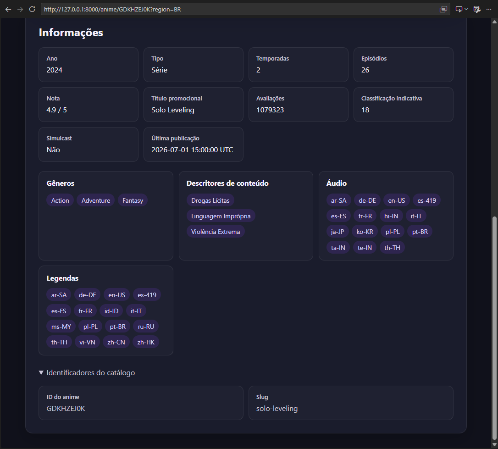
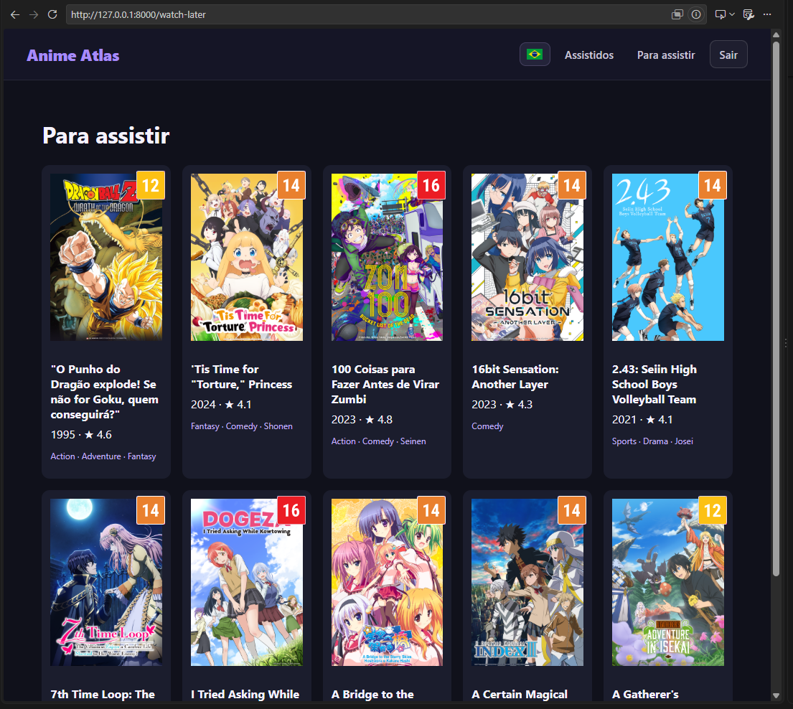
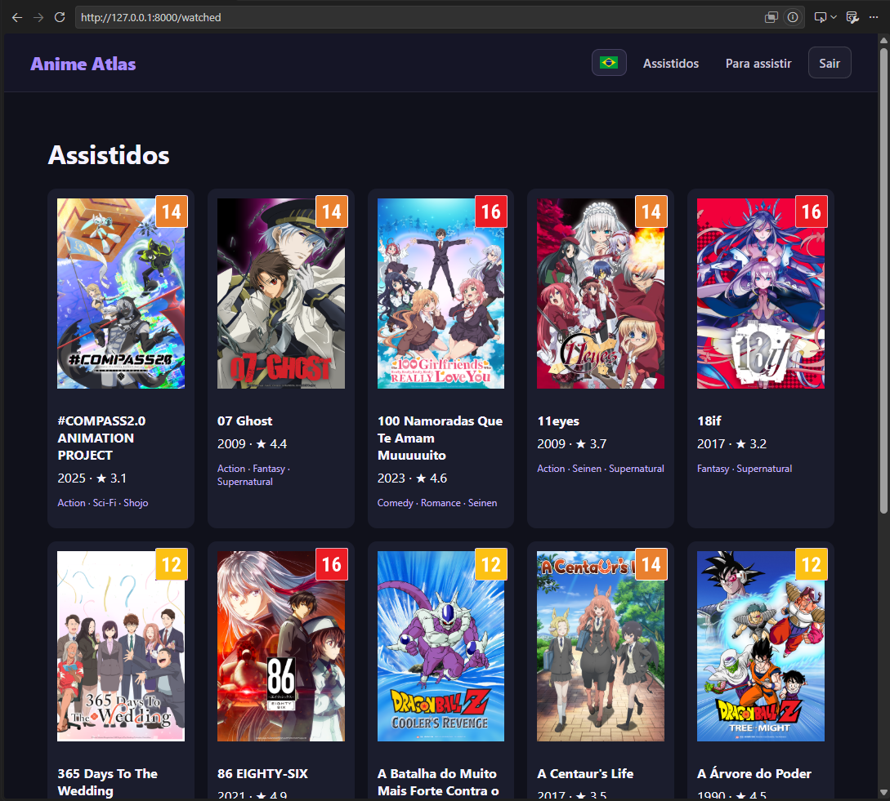
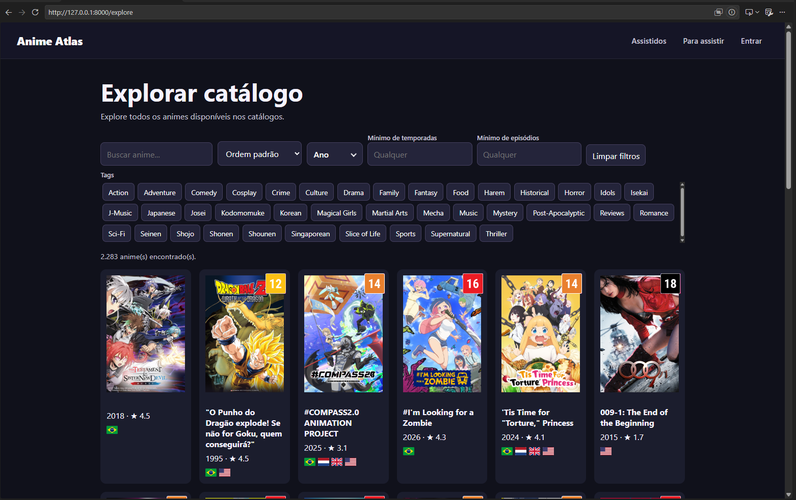

# Anime Atlas

**Descubra seu próximo anime com filtros mais completos e catálogos de diferentes regiões.**

O Anime Atlas é uma interface alternativa para explorar o catálogo da Crunchyroll, desenvolvida para tornar a descoberta de animes mais prática e flexível. Com busca avançada, filtros personalizáveis e navegação por catálogos regionais, o projeto oferece mais controle sobre como encontrar títulos para assistir.

## Demonstração temporária

[Acesse o Anime Atlas](https://anime-atlas-ehpe.onrender.com).

Esta demonstração pública é uma prova de conceito temporária. O catálogo não será atualizado por enquanto; a coleta e a criação do banco de dados serão tratadas por outro projeto. Contas e listas de usuários podem ser apagadas periodicamente. Não use uma senha que você já utiliza em outros serviços.

## Funcionalidades

- **Busca avançada:** pesquise por título, gênero ou sinopse.
- **Filtros combináveis:** refine os resultados por ano, tags, classificação indicativa, descritor de conteúdo, idioma de áudio, disponibilidade de legendas, nota mínima, status e outros critérios disponíveis.
- **Filtros personalizados:** ajuste os critérios de busca para encontrar títulos que correspondam às suas preferências.
- **Catálogos regionais:** navegue pelos catálogos das diferentes regiões cujos dados foram coletados e incluídos na base.
- **Filtros de idioma e legenda:** selecione idiomas específicos de áudio e filtre títulos pela disponibilidade de legendas.
- **Lista de assistidos:** acompanhe os animes que você já assistiu.
- **Lista para assistir:** mantenha uma lista de títulos que pretende assistir.
- **Páginas de detalhes:** consulte informações individuais sobre cada anime.
- **Busca, ordenação e paginação:** explore o catálogo sem precisar carregar todos os registros de uma só vez.

## Screenshots

### Página inicial



### Busca e filtros



### Personalização dos filtros



### Detalhes do anime




### Lista para assistir



### Lista de assistidos



### Catálogos de diferentes regiões



## Catálogos regionais

A disponibilidade de animes, idiomas de áudio e legendas pode variar entre regiões. O Anime Atlas permite navegar pelos catálogos regionais presentes na base de dados, oferecendo uma visão mais ampla das opções disponíveis.

A cobertura regional depende dos dados coletados e mantidos no projeto. Novas regiões podem ser adicionadas conforme novos catálogos forem obtidos e processados.

## Como funciona

A aplicação utiliza uma API desenvolvida com FastAPI para consultar e disponibilizar os dados do catálogo. As operações de busca, filtragem, ordenação e paginação são executadas diretamente no SQLite, evitando carregar todo o catálogo em memória.

Os dados são fornecidos pelo projeto [`anime-data`](../anime-data), que mantém o catálogo em um banco SQLite normalizado.

## Tecnologias

- Python
- FastAPI
- SQLite
- Uvicorn
- Pytest
- Ruff

## Planos futuros

Se o projeto ganhar tração e contar com apoio da comunidade, pretendo desenvolver um processo recorrente de atualização dos catálogos para diferentes regiões da Crunchyroll.

A ideia é ampliar a cobertura regional e manter os dados atualizados, tornando o Anime Atlas mais acessível a outros usuários.

## Executar localmente

### Pré-requisitos

- Python instalado.
- Um banco `anime-data.db` gerado pelo projeto `anime-data`, ou outro arquivo SQLite compatível com o esquema esperado pela aplicação.

### Instalação

Os comandos abaixo são para Windows com PowerShell.

1. Crie e ative um ambiente virtual:

   ```powershell
   python -m venv .venv
   .\.venv\Scripts\Activate.ps1
   ```

2. Instale as dependências:

   ```powershell
   pip install -r requirements.txt
   ```

3. Configure o caminho do banco de dados, se necessário. Por padrão, a aplicação procura o arquivo em `../anime-data/anime-data.db`.

   ```powershell
   $env:ANIME_DATABASE_PATH = "C:\caminho\para\anime-data.db"
   ```

4. Inicie a aplicação:

   ```powershell
   uvicorn app.main:app --reload
   ```

### Acessar a aplicação

- **Catálogo:** http://127.0.0.1:8000
- **Documentação interativa da API:** http://127.0.0.1:8000/docs

Para permitir acesso a outros dispositivos na rede local:

```powershell
uvicorn app.main:app --host 0.0.0.0 --port 8000 --reload
```

### Validação e qualidade de código

```powershell
python scripts/validate_data.py
pytest
ruff check .
ruff format --check .
```

O validador verifica inconsistências, como divergências na contagem total de registros e IDs duplicados, sem modificar os dados de origem.

## API

| Endpoint | Descrição |
|---|---|
| `GET /` | Página inicial |
| `GET /anime/{id}` | Página de detalhes de um anime |
| `GET /api/animes` | Lista animes com busca, filtros e paginação |
| `GET /api/animes/{id}` | Retorna os detalhes de um anime |
| `GET /api/filters` | Retorna as opções disponíveis para os filtros |
| `GET /api/categories` | Retorna as tags do catálogo |

Exemplo de consulta:

```http
GET /api/animes?q=acao&year=2025&min_rating=4&page=1
```

## Aviso

O Anime Atlas é um projeto independente, sem afiliação, patrocínio ou associação oficial com a Crunchyroll. A disponibilidade e a precisão das informações dependem dos dados coletados para o catálogo.

Contribuições, sugestões e melhorias são bem-vindas.
